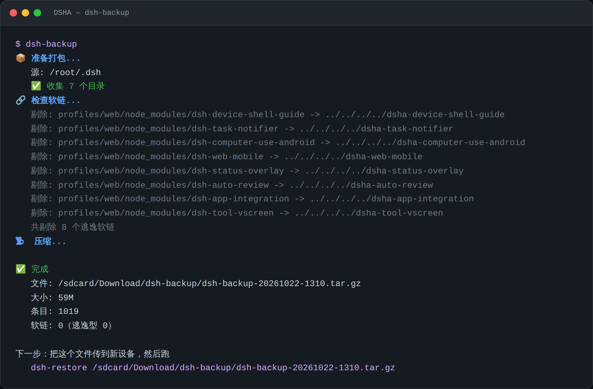

# dsh-tools

Two commands that give [DSHA](https://github.com/) a backup you can **actually restore**.

```bash
dsh-backup          # back up, ~10 seconds
dsh-restore <file>  # restore
```

[中文说明](README.md)



---

## 🚀 Quick start (no commands needed)

**Open DSHA, copy the whole block below, paste it into the chat, send.**

```
Install this backup tool for me: https://github.com/sb1145148/dsh-tools
Then run a backup immediately and tell me:
  1. where the backup file is
  2. how big it is
  3. whether it reported any "escaping symlinks"
```

**The AI downloads, installs and runs the backup itself. You just read the result.**

You should see something like:

```
✅ 完成
   文件: /sdcard/Download/dsh-backup/dsh-backup-20261022-1244.tar.gz
   大小: 59M
   条目: 1019
   软链: 0（逃逸型 0）
```

---

## 📥 I downloaded it — now what?

**One-line install** (no manual extraction):

```bash
curl -fsSL https://raw.githubusercontent.com/sb1145148/dsh-tools/main/install-online.sh | sh
```

**Or install from source:**

```bash
curl -L https://github.com/sb1145148/dsh-tools/releases/latest/download/dsh-tools-1.0.2.tar.gz \
  | tar -xz
cd dsh-tools && sh install.sh
```

**Install somewhere else:**

```bash
sh install.sh --prefix ~/bin
```

You should see:

```
📦 dsh-tools 1.0.2
   安装到: /usr/local/bin
   ✅ /usr/local/bin/dsh-backup
   ✅ /usr/local/bin/dsh-restore
✅ 已在 PATH 里，直接敲 dsh-backup 就行
```

Two ✅ means it's installed.

---

## 📁 Where is the backup file

```
/sdcard/Download/dsh-backup/dsh-backup-<date>-<time>.tar.gz
```

Each backup gets a new timestamped filename — old ones are never overwritten.

---

## 📱 Moving to a new phone

```
Old phone                         New phone
────────────────────────────────────────────
① dsh-backup
   ↓ transfer the file
                              ② rebuild the environment (do NOT import yet)
                                   ↓
                              ③ install dsh-tools
                                   ↓
                              ④ dsh-restore
                                   ↓
                              ⑤ restart Web
```

### ⚠️ The step everyone gets wrong

**Rebuild the environment first, import data second.**

```
❌ Import first  → environment is broken, data can't run anyway
✅ Rebuild first → verify it works, then import
```

To rebuild:

```
Settings → Apps → DSHA → Storage → Clear data
Then open the app and let it install itself (3–10 min)
```

**Before you start, allow background activity** (otherwise the install gets killed halfway):

```
Settings → Battery → Background power management → DSHA → Allow high background usage
Settings → Apps → DSHA → Battery → Unrestricted
Settings → Apps → DSHA → Autostart → Allow
```

---

## ❓ FAQ

### I downloaded it but don't know where to put it

**Send this to the AI:**

```
I downloaded the dsh-tools archive into /sdcard/Download/.
Please extract it, install it, and run a backup.
```

### `dsh-backup: command not found`

The install didn't finish, or it went somewhere not on `PATH`.

Re-run `sh install.sh` and check whether the last line is the green "已在 PATH 里".

### I ran the backup but can't find the file

```
Find the backup file dsh-backup just created and show me its path and size.
```

### Old conversations are missing after restore

Most likely the `sessions` directory name doesn't match:

```bash
ls ~/.dsh/sessions/
```

It should look like `--root-xxx--`, matching the current workspace path.

### It mentions "逃逸软链" (escaping symlinks)

If `软链:` in the output isn't `0`, there are still links pointing outside the archive.
Send the output to the AI so it can inspect them.

### How long / how big

- **Time:** ~10 seconds
- **Size:** ~10 MB (code + conversations) to ~70 MB (with attachments and meme packs)

### Does it back up automatically?

**No.** It's a manual command — you run it, it runs once. Once before a phone migration is enough.

---

## 🆘 Error on the new device? Check these three things first

**90% of migration problems are one of these three.** Check in order.

---

### ① Is the tool installed?

```bash
command -v dsh-restore
```

**Prints a path** (e.g. `/usr/local/bin/dsh-restore`) → installed, go to ②

**Prints nothing** → **not installed**:

```bash
curl -fsSL https://raw.githubusercontent.com/sb1145148/dsh-tools/main/install-online.sh | sh
```

> ⚠️ **Every "Clear data" + environment rebuild wipes `/usr/local/bin`.**
> Having it on the old phone does not mean the new phone has it.

**This is the most common one.** The error looks like:

```
dsh-restore: not found
No such file or directory
```

---

### ② Does the file exist?

```bash
ls -l /sdcard/Download/dsh-backup-*.tar.gz
```

**Prints a line** → it's there. Check the size — should be around **60 MB**.

**Prints nothing** → search wider:

```bash
find /sdcard/Download -maxdepth 2 -name "*.tar.gz" 2>/dev/null
```

> 💡 **"Internal storage" in your file manager is `/sdcard` on the command line.**
> Don't type the translated name into the shell.

**Common traps:**

| Situation | Symptom |
| --- | --- |
| File is in a subfolder | Path missing a level |
| Transfer incomplete | Size doesn't match (a few MB) |
| Filename has spaces or CJK | **Must be quoted** |
| **File exists but unreadable** | `ls` lists it, restore says `Permission denied` |

---

#### ⚠️ Special case: `ls` shows it, but it can't be read

**`/sdcard` is a FUSE mount with SELinux and uid restrictions.** root inside the environment is not real root:

```
ls -l  →  directory read permission  →  ✅ lists fine
open() →  actual file open           →  ❌ denied
```

**How to tell:**

```bash
ls -l "$F"                  # prints a line
head -c 1 "$F" >/dev/null   # Permission denied → this is it
```

**Two fixes:**

1. **Grant access**: Settings → Device capabilities → File access
2. **Work around it**: copy into the workspace first

```bash
cp "$F" ~/ && dsh-restore ~/$(basename "$F")
```

**`~/` is inside the workspace, so the `/sdcard` restriction doesn't apply.**

---

### ③ Does the directory name match?

**This is why a successful restore can still show no old conversations.**

```bash
ls ~/.dsh/sessions/
```

Should print **one** directory named like:

```
--root-deepseek-harness--
```

**The name is derived from the workspace path** (slashes replaced with `-`).

**If it doesn't match, old conversations won't appear.** Send both:

```bash
ls ~/.dsh/sessions/     # current directory name
pwd                     # current workspace
```

---

### 📊 Error → cause

| What you see | Which check |
| --- | --- |
| `dsh-restore: not found` | **① not installed** |
| `bash: /sdcard/...: No such file` | **② wrong path** |
| `❌ 找不到文件: /sdcard/...` | **② wrong path** |
| Restore succeeded but no conversations | **③ name mismatch** |
| Only the usage message printed | Argument split by spaces → **quote it** |

---

## 🤔 Why this exists

DSHA's built-in "Backup and restore" currently has a bug:

```
backup  → ✅ succeeds
restore → ❌ fails with ARCHIVE_LINK_ESCAPE
```

The generated `portable.dshbak` keeps symlinks from `node_modules` that point outside
the archive root (51 of them in my test). The restore-side safety check refuses to create
them, so the whole restore fails.

**Which makes phone-to-phone migration impossible.**

This tool strips those links at **packaging time**, so the restore goes through.

---

## 🔧 Reference

```bash
# install elsewhere
sh install.sh --prefix ~/bin

# back up
dsh-backup

# restore (leaves state files alone by default)
dsh-restore /sdcard/Download/dsh-backup/xxx.tar.gz

# restore state files too (careful)
dsh-restore xxx.tar.gz --all

# roll back plugins
rm -rf ~/.dsh/plugin-src
mv ~/.dsh/plugin-src.before-restore ~/.dsh/plugin-src
```

**Included:**

```
sessions/      conversation history
attachments/   images and files from conversations
plugin-src/    plugin source
meme-packs/    sticker packs
plugin-kits/   plugin packages
profiles/      profile configs
config/        settings (no credentials)
home/          shell config and notes
```

**Deliberately excluded:**

| Item | Why |
| --- | --- |
| State files (`plugin-activations.json` etc.) | Overwriting them breaks the new environment |
| `.bridge_headers` and other credentials | Must not leave the device |
| `node_modules` / caches / logs | Regenerable |
| Symlinks pointing outside the archive | The source of the bug |
| The whole Linux environment | Several GB, never portable across devices |

---

## 📋 Compatibility

- DSHA `0.2.21-*` (`session.v4.jsonl.zstd` format)
- GNU tar 1.35+
- Depends only on `sh` / `tar` / `find` / `cp`

---

## 📄 License

MIT
